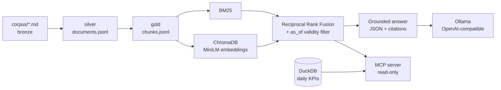

# Ops Knowledge Copilot

Answers operations questions from versioned company documents, with citations, and says
"I don't know" when the documents don't have the answer. It also exposes the documents and daily
KPIs to any [MCP](https://modelcontextprotocol.io) client (Claude Desktop, VS Code, ...).

Runs on a laptop, on CPU, with a local model. Cost: $0.

> The company (Fogline Hospitality Group) and all 32 documents are synthetic.

## Why this is harder than "RAG over PDFs"

Operations documents change. Procedures get new versions, contracts expire, a memo overrides
a policy for three months. A plain vector search happily returns the old fee or the expired
supplier. This project treats that as the core problem:

- **Validity-aware retrieval.** Every chunk carries `effective_from` / `effective_to`. A question
  is asked "as of" a date, and superseded or expired documents never reach the model.
- **Citations enforced in code.** An answer without a valid citation is not shown. If search
  finds nothing, the model is not called.
- **Measured, not assumed.** 80 hand-built questions with deterministic scoring, a held-out set,
  and CI gates on the saved results.

## Results

Default configuration: `qwen2.5:7b`, prompt v1, matching sections, hybrid search
([ADR 0001](../../docs/decisions/0001-model-prompt-and-retrieval.md)).

| Set | Questions | Pass rate | Wrong answers | False abstentions |
|---|---|---|---|---|
| Development | 60 | 92% | 2% | 8% |
| Held-out (never used to tune) | 20 | 80% | 10% | 13% |

The held-out number is the honest one. I compared two models, two prompts and two context
strategies; the model mattered, the prompt variants did not generalise (one improved the
development score and nothing else). Full tables: [`evals/REPORT.md`](evals/REPORT.md).

Retrieval, development set: hybrid recall@6 100%, MRR 0.949.

**Known limitations.** Questions were written with AI help. Scoring is string and citation
matching, not human review. Samples are small (one question = 5 points on the held-out set).
The corpus is synthetic. Prompt-injection cases are at question level only. Four held-out
questions fail with every qwen variant; I looked at them to diagnose, did not fix them, and
list them as open.

## Architecture



- **Ingestion** (medallion): parse and validate with Pydantic contracts, quarantine bad files,
  chunk by section (156 chunks), deterministic output hashes.
- **Retrieval**: BM25 plus vectors fused with RRF, filtered by date.
- **Generation**: any OpenAI-compatible endpoint (Ollama by default); abstention and citation
  rules live in code, not only in the prompt.
- **MCP server**: tools `search_documents`, `get_document`, `list_kpis`, `query_kpi`. Read-only.
  KPIs use fixed SQL with bound parameters; there is no free-form SQL.

## Run it

Requires [uv](https://docs.astral.sh/uv/) and [Ollama](https://ollama.com) with `qwen2.5:7b`.

```powershell
ollama pull qwen2.5:7b
uv sync
uv run poe ingest
uv run poe ask "What time is check-in at Fogline Marina?"
uv run poe check        # lint, format, tests
```

Re-run the evals (about an hour on CPU): `uv run poe eval-all`, then `uv run poe eval-report`.

## KPIs from the lakehouse

By default the KPI tools read a synthetic sample. Point `OPS_COPILOT_KPI_DIR` at the folder that
[project 01](../01-revenue-lakehouse/README.md) exports and they read the real gold tables instead
(`uv run poe lh-all`, then `uv run poe mcp-lakehouse`). The CSV header is checked against
`contracts/gold_kpis.yaml` before it is used, every answer says where its numbers came from, and
a table the lakehouse does not produce yet still falls back to the sample.

## Use it from an MCP client

Verified with the official [MCP Inspector](https://github.com/modelcontextprotocol/inspector)
(`npx @modelcontextprotocol/inspector uv run python -m ops_copilot.mcp_server`). Setup for VS Code
and Claude Desktop is in [docs/mcp-clients.md](docs/mcp-clients.md); those two configurations are
provided but I have not been able to test them on my machine.

## A bug worth telling

A network failure while downloading the embedding model left an empty vector index on disk, and
the next run reused it silently: vector search returned nothing and only BM25 worked. The fix:
compute embeddings before creating the collection, and reuse an index only if its fingerprint
matches and every chunk is present. Two regression tests cover it.
